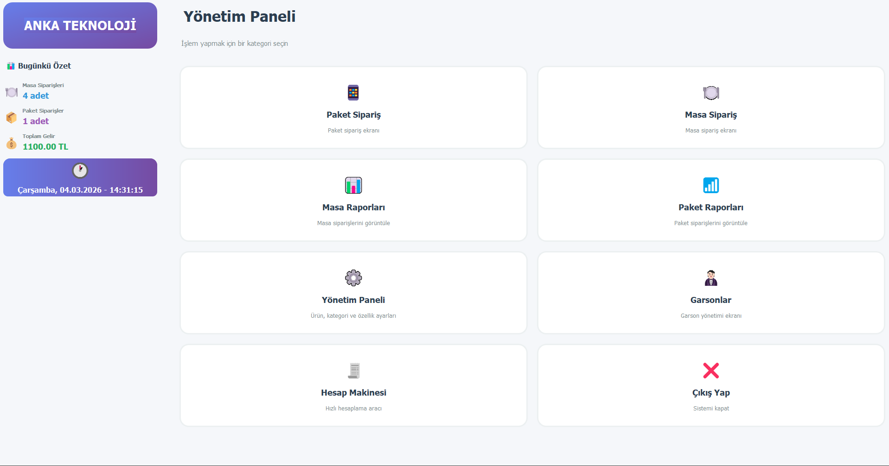
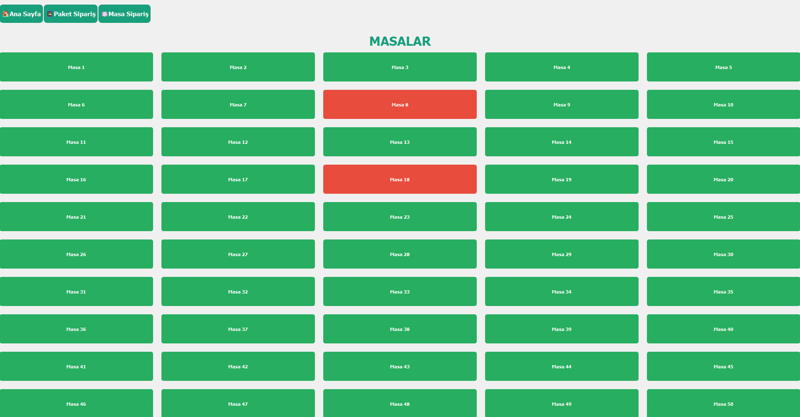
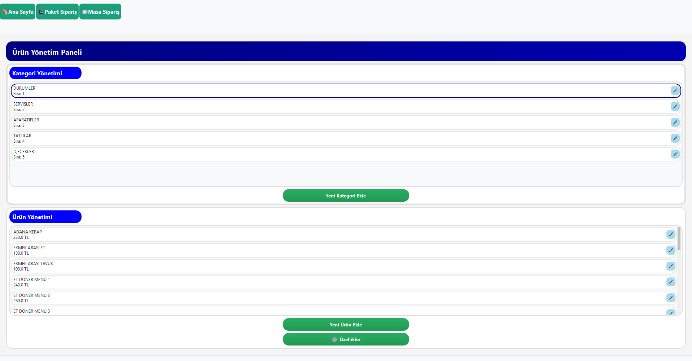
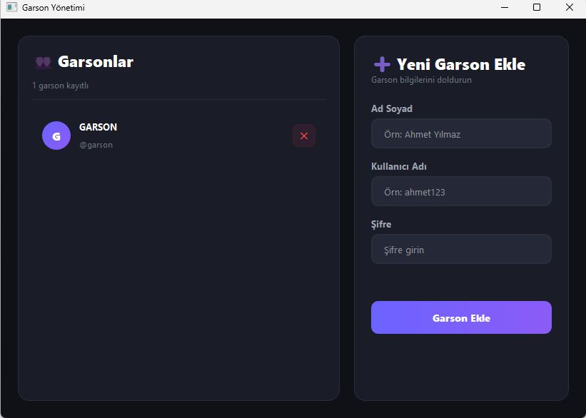
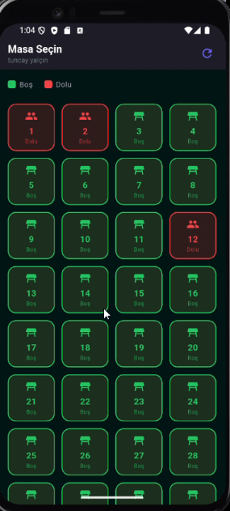

<p align="center">
  
</p>

<h1 align="center">Yalçınlar POS</h1>

<p align="center">
  Restoranlar için masa, paket servis ve kurye yönetim sistemi<br>
  <sub>Windows masaüstü uygulaması + 3 mobil uygulama, gerçek zamanlı senkronizasyon</sub>
</p>

<p align="center">
  
  
  
  
  
</p>

> **Not:** Bu depo projenin tanıtım sayfasıdır. Kaynak kodu ticari bir üründe kullanıldığı için gizlidir.
>
> *This is a showcase repository. The source code is private because the system is in commercial use at a live restaurant.*

---

## Nedir?

Yalçınlar POS, bir restoranın günlük işleyişini tek sistemde toplar. Sipariş garsondan ya da telefondan gelir, kasada toplanır ve kuryeyle müşteriye ulaşır. Bu sürecin tamamı anlık olarak takip edilir. Kasadaki bilgisayar programı ile garson, kurye ve numara alma uygulamaları birbirine bağlı çalışır. Bir yerde girilen sipariş, saniyeler içinde diğer ekranlarda görünür.

Sistem şu anda gerçek bir restoranda canlı olarak kullanılmaktadır.

## Ekran Görüntüleri

<p align="center">
  <br>
  <sub>Ana sayfa: günün özeti ve tüm modüllere erişim</sub>
</p>

<p align="center">
  <br>
  <sub>Masa ekranı: dolu masalar kırmızı, boş masalar yeşil</sub>
</p>

<table>
  <tr>
    <td width="70%" align="center">
      <br>
      <sub>Menü yönetimi: kategori, ürün ve fiyatlar</sub>
      <br><br>
      <br>
      <sub>Garson hesaplarının yönetimi</sub>
    </td>
    <td width="30%" align="center">
      <br>
      <sub>Garson mobil uygulaması: masa seçimi</sub>
    </td>
  </tr>
</table>

## Sistem Bileşenleri

```
            ┌──────────────────────┐
            │   Firebase (Cloud)   │
            │ Firestore + Realtime │
            └──────────┬───────────┘
      ┌────────────┬───┴────────┬─────────────┐
      ▼            ▼            ▼             ▼
 ┌─────────┐  ┌─────────┐  ┌─────────┐  ┌─────────────┐
 │  Kasa   │  │ Garson  │  │  Kurye  │  │ Numara Alma │
 │ (PyQt5) │  │(Flutter)│  │(Flutter)│  │  (Flutter)  │
 └─────────┘  └─────────┘  └─────────┘  └─────────────┘
```

### 🖥️ Masaüstü Program (Kasa)
- **Masa siparişleri:** Masa durumları renklerle görünür (boş / dolu / siparişte). Ürün eklenip çıkarılabilir, ikram yapılabilir, hesap nakit veya kartla kapatılır.
- **Paket siparişler:** Telefon siparişi girilir, bekleyen siparişler takip edilir.
- **Kurye yönetimi:** Sipariş kuryeye atanır, kurye durumları (boşta / yolda) izlenir, kuryeye anlık bildirim gider.
- **Arayan numara:** Restoranı arayan müşterinin numarası ekrana otomatik düşer.
- **Menü yönetimi:** Kategori, ürün, fiyat ve ürün özellikleri yönetilir.
- **Fiş yazdırma:** ESC/POS termal yazıcı desteği vardır.
- **Raporlar:** Masa, paket, kurye ve ürün satış raporları ile günlük Z raporu alınır, raporlar Excel'e aktarılır.
- **Güvenlik:** Sipariş iptali gibi kritik işlemler şifreyle doğrulanır.
- **Otomatik güncelleme:** Yeni sürümler restorana gitmeye gerek kalmadan kurulur.

### 📱 Garson Uygulaması
Garson masaları telefonundan görür ve masada sipariş alır. Ürün ile özellikleri seçip siparişi gönderdiğinde sipariş anında kasaya düşer.

### 🛵 Kurye Uygulaması
Kurye kendisine atanan siparişleri görür ve yeni sipariş geldiğinde bildirim alır. "Paketi aldım", "Teslim ettim" adımlarını ve ödeme bilgisini uygulamadan girer. Müşteri konumunu haritada açabilir, geçmiş teslimatlarını ve aylık raporlarını izleyebilir.

### 📞 Numara Alma Uygulaması
Restoran hattının takılı olduğu Android telefona kurulur ve gelen aramaların numarasını kasaya iletir.

## Teknolojiler

| Katman | Teknoloji |
|---|---|
| Masaüstü | Python 3.13, PyQt5, PyInstaller, Inno Setup |
| Mobil | Flutter (Dart), Provider, Geolocator |
| Backend | Firebase Firestore, Realtime Database, Authentication, Cloud Messaging (FCM) |
| Donanım | ESC/POS termal yazıcı (win32print) |
| Raporlama | openpyxl (Excel) |

## Öne Çıkan Teknik Detaylar

- **Düşük bulut maliyeti:** Tüm ekranlar tek bir paylaşılan Firestore dinleyicisi ve önbellek kullanır. Program boştayken veritabanı okuması neredeyse sıfırdır.
- **Gerçek zamanlı senkronizasyon:** Kasa ve mobil uygulamalar arasındaki sipariş ve kurye durumu değişiklikleri anlık yansır.
- **Uzaktan güncelleme:** Sürüm bilgisi bulutta tutulur, program açılışta kontrol eder ve yeni sürümü kendisi kurar.
- **Hata yakalama:** Beklenmeyen hatalar program kapanmadan yakalanır ve kullanıcıya anlaşılır biçimde gösterilir.

---

<p align="center">
  Geliştirici: <a href="https://github.com/TuncayYlcn">Tuncay Yalçın</a>
</p>
